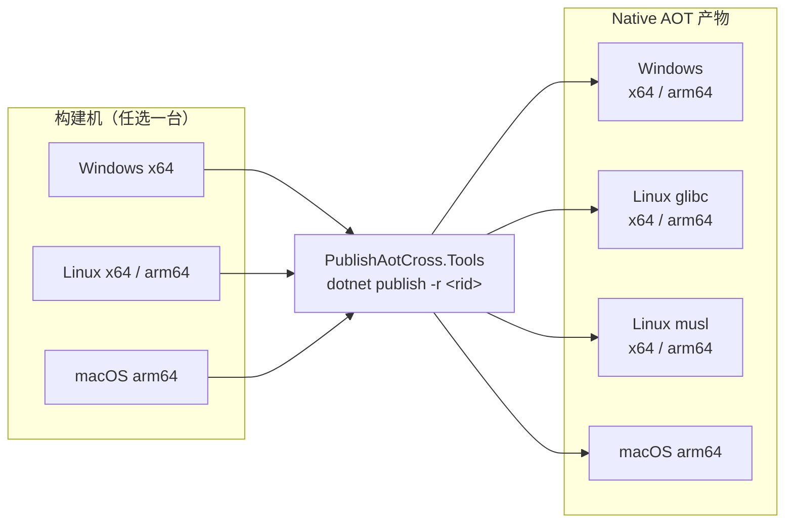

# PublishAotCross.Tools：让 .NET 应用的跨平台 AOT 交叉编译变得简单

> 一条命令构建全平台，无需为每个平台准备构建机

## 一、痛点：一行红字拦住了整个发布流程

你用 .NET 写了个服务，开启了 Native AOT，想要极致启动速度和单文件部署。现在要把产物发到多个平台：Windows、Linux，还有 macOS。

于是你在 CI 里写下：

```
dotnet publish -c Release -r linux-x64
```

结果迎面一行红字：

```
error : Cross-OS native compilation is not supported.
```

翻文档才知道：Native AOT 依赖每个操作系统的原生链接器，微软官方**只支持同平台构建**——Windows 上只能构建 Windows，Linux 上只能构建 Linux。想跨平台？要么为每个平台准备一台构建机，要么自己折腾交叉编译工具链。

如果你也被这个问题卡过，这篇文章就是为你准备的。

## 二、为什么 Native AOT 值得你忍受这些

先说为什么大家还是想用 Native AOT：

- **启动极快**：无需 JIT 预热，毫秒级启动
- **内存更低**：没有 JIT 堆和运行时元数据
- **单文件部署**：一个本机可执行文件，自包含、无需安装运行时
- **体积更小**：未使用的代码被裁剪掉

代价就是开头那个报错：它的跨平台能力先天不足。

## 三、你可能试过的办法，以及它们的问题

**装 Visual Studio C++ 工具链**：只能在 Windows 上用，安装包 5GB+，CI 里装它最重。

**用 Docker 交叉构建**：配置繁琐、每次拉镜像、不适合 Windows 目标，也搞不定 macOS。

**手动配置交叉编译工具链**：能行，但要自己下载编译器、配环境变量、管版本，CI 里还得维护一堆脚本。

共同点：**都不够"开箱即用"**。

## 四、解药：PublishAotCross.Tools

`PublishAotCross.Tools` 是一个 NuGet 包。加上它，你就能**在一台机器上，用自己的 `dotnet publish`，直接产出所有目标平台的 Native AOT 二进制**。

- 不用装 Visual Studio
- 不用装 extra 编译器
- 不用 Docker
- 不用管理员权限
- 甚至**不用 Mac**，也能产出 macOS（Apple Silicon）的产物

一切工具链都随 NuGet 包自动就位。



## 五、3 分钟上手

### 第 1 步：加一个包引用

在已经开启 Native AOT 的项目里：

```xml
<Project Sdk="Microsoft.NET.Sdk">
  <PropertyGroup>
    <OutputType>Exe</OutputType>
    <TargetFramework>net10.0</TargetFramework>
    <PublishAot>true</PublishAot>
    <InvariantGlobalization>true</InvariantGlobalization>
    <RuntimeIdentifiers>win-x64;win-arm64;linux-x64;linux-arm64;linux-musl-x64;linux-musl-arm64;osx-arm64</RuntimeIdentifiers>
  </PropertyGroup>

  <PropertyGroup>
    <DebugType>none</DebugType>
  </PropertyGroup>

  <ItemGroup>
    <PackageReference Include="PublishAotCross.Tools" Version="1.0.1.13" />
  </ItemGroup>
</Project>
```

支持 `.NET 8 / 9 / 10`，`<TargetFramework>` 按你的项目填即可。
`<DebugType>none</DebugType>` 表示不保留调试符号；符号剥离由包内自带的 `llvm-objcopy` 自动完成，无需手工设置，产物已很精简。

### 第 2 步：想构建哪个平台，就敲哪条命令

```bash
# Windows（无需 Visual Studio）
dotnet publish -c Release -r win-x64
dotnet publish -c Release -r win-arm64

# Linux（glibc）
dotnet publish -c Release -r linux-x64
dotnet publish -c Release -r linux-arm64

# Linux（musl / Alpine）
dotnet publish -c Release -r linux-musl-x64
dotnet publish -c Release -r linux-musl-arm64

# macOS（Apple Silicon）—— 不需要 Mac
dotnet publish -c Release -r osx-arm64
```

就这些。全部在本机完成，不用切系统、不用装工具链。

> 这些命令在 Windows、Linux、macOS 上任一宿主都能跑。比如在 Linux CI 上执行 `-r osx-arm64`，就能直接得到可在 Apple Silicon 运行的二进制。

## 六、支持的平台

| 宿主 \ 目标 | win-x64 | win-arm64 | linux-x64 | linux-arm64 | linux-musl-x64 | linux-musl-arm64 | osx-arm64 |
| --- | :-: | :-: | :-: | :-: | :-: | :-: | :-: |
| **Windows x64** | ✅ | ✅ | ✅ | ✅ | ✅ | ✅ | ✅ |
| **Linux x64** | ✅ | ✅ | ✅ | ✅ | ✅ | ✅ | ✅ |
| **Linux arm64** | ✅ | ✅ | ✅ | ✅ | ✅ | ✅ | ✅ |
| **macOS arm64** | ✅ | ✅ | ✅ | ✅ | ✅ | ✅ | ✅ |

一句话：**任选一台 Windows 或 Linux 机器，就能产出全部目标平台的产物**（含 macOS arm64），无需 Mac。

## 七、常用参数

- **兼容旧 Linux 发行版**：`/p:GlibcVersion=2.35`（指定 glibc 版本）
- **剥离符号**：非 Windows 目标**默认开启**（包内自带多格式 `llvm-objcopy`）；如需保留符号可加 `/p:StripSymbols=false`
- **改回系统原生工具链**：`-p:AotPreferCustom=false`（默认用包内置工具链，保证环境一致）

## 八、在 CI 里就一条命令

以 GitHub Actions 为例，**一个 runner 就能打包全部平台，连 Mac 都不用**：

```yaml
name: Publish Native AOT

on:
  push:
    tags: [ 'v*' ]

jobs:
  build:
    runs-on: ubuntu-latest
    strategy:
      matrix:
        rid:
          - win-x64
          - win-arm64
          - linux-x64
          - linux-arm64
          - linux-musl-x64
          - linux-musl-arm64
          - osx-arm64

    steps:
      - uses: actions/checkout@v4
      - uses: actions/setup-dotnet@v4
        with:
          dotnet-version: 10.0.x

      - name: Publish for ${{ matrix.rid }}
        run: dotnet publish -c Release -r ${{ matrix.rid }}

      - uses: actions/upload-artifact@v4
        with:
          name: app-${{ matrix.rid }}
          path: bin/Release/net10.0/${{ matrix.rid }}/publish/
```

不用为每个平台准备构建机，不用装 VS，不用维护 Docker 镜像，**也不用排队等 macOS runner**。

## 九、常见问题

**Q：macOS 产物在 Apple Silicon 上能直接跑吗？**
可以，无需额外签名。

**Q：需要装 Dart/Go/Zig 等外部工具吗？**
不需要，工具链随 NuGet 包自动就位，`dotnet restore` 时解压即可。

**Q：不想用内置工具链怎么办？**
加 `-p:AotPreferCustom=false`，回退到系统原生工具链。

**Q：支持哪些 .NET 版本和 RID？**
.NET 8+；目标 RID 见上面的支持矩阵。

## 十、试试看

如果你的项目也在为"发布多个平台"头疼，尤其是"要出 macOS 就得有台 Mac"这件事——

**加一个 NuGet 包，把 `.csproj` 里的 RID 列表补上，然后敲一条 `dotnet publish` 就好了。**

- GitHub：`DotNet-AGPL/PublishAotCross.Tools`（https://github.com/DotNet-AGPL/PublishAotCross.Tools）
- 安装：`dotnet add package PublishAotCross.Tools`
- 基于 **Apache-2.0** 许可，可自由用于商业与闭源项目

欢迎 Star、提 Issue、提 PR。祝构建顺利。
