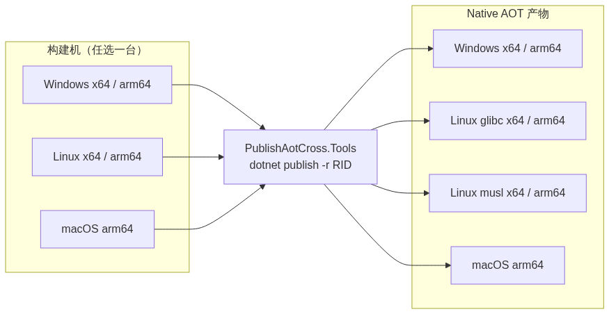

# 公众号发布说明（不进入正文）

配套文件：
- 正文源（Markdown）：`docs/article-wechat.md`（已完成公众号适配：去外链、Mermaid 换图片）
- 正文（**内联样式 HTML，可直接粘贴**）：`docs/article-wechat.html`
- 配图：`docs/article-wechat-diagram.png`（架构图，需手动上传）

---

## 1. 标题 / 摘要

**标题**（公众号「标题」字段，≤ 64 字）：

> PublishAotCross.Tools：让 .NET 应用的跨平台 AOT 交叉编译变得简单

**摘要**（公众号「摘要」字段，建议 ≤ 120 字）：

> Native AOT 启动快、体积小，却只能同平台构建。PublishAotCross.Tools 让它在 Windows/Linux 上一条命令交叉编译到 Windows、Linux（glibc/musl）与 macOS——不用 Mac、不用 Visual Studio 的 C++ 工具链，装个 .NET SDK 就能用。

---

## 2. 配图处理（重要）

正文里的

```

```

**不能直接粘贴**（公众号不认本地路径）。做法：

1. 把 `docs/article-wechat-diagram.png` 上传到公众号素材库（或直接在编辑器里用「图片」按钮插入）；
2. 再把正文中那行占位图片删掉/替换为刚插入的图。

> 该图由 Mermaid 渲染，如需重新生成：改 `docs/article-draft.md` 里的 mermaid 块后，用 mermaid.ink 出图即可。

---

## 3. 外链处理（重要）

公众号正文**不能放外部超链接**。已处理：

- 正文中 GitHub 链接改为纯文本 **`DotNet-AGPL/PublishAotCross.Tools`**；
- 请在编辑器里把 **「阅读原文」** 指向：
  `https://github.com/DotNet-AGPL/PublishAotCross.Tools`
- 代码块内的命令（`dotnet add package ...`）不受影响。

---

## 4. 排版流程（两种方式，任选）

公众号编辑器只接受富文本，且会剥掉 `<style>`。两种做法：

**方案 A（推荐，免第三方工具；样式已内联）**

1. 用浏览器打开 `docs/article-wechat.html`；
2. 从标题开始全选（Ctrl+A）→ 复制；
3. 直接粘贴到公众号编辑器（样式已内联，不会掉格式）；
4. 粘贴后手动插入架构图（见 §2）。

**方案 B（用第三方排版工具）**

1. 打开 **mdnice**（https://mdnice.com）或 **doocs/md**（https://md.doocs.org）；
2. 把 `docs/article-wechat.md` 全文粘贴进去（Markdown 实时渲染）；
3. 选一个主题，点「复制」，粘贴到公众号编辑器。

> 方案 A 的样式固定（标题左侧色条 / 代码块 / 引用 / 表格已内联）；想换主题用方案 B。HTML 由 `marked` + `juice` 从 `docs/article-wechat.md` 生成。

---

## 5. 已知注意点

- **支持矩阵已精简为 2 列**（「宿主 → 可产出」），手机端友好。完整 7 列矩阵只在 `docs/article-draft.md`（草稿）里保留。
- **代码块**：公众号对代码块支持一般，粘贴后检查等宽字体与换行；必要时截图成图片。
- **「开箱即用」已收敛为 2 处**（副标题 + 第 4 段），不显重复。
- **原创声明**：若开原创，注意文中第三方商标（.NET / Visual Studio / GitHub / Zig）用法，不涉及转载图片即可。

---

## 6. 发布前 Checklist

- [ ] 「标题」已填入（见 §1）
- [ ] 「摘要」已填入（见 §1）
- [ ] 架构图已上传并替换正文占位图（**两种排版方式都要手动插图**）
- [ ] 正文内**无 http(s) 超链接**
- [ ] 「阅读原文」指向 GitHub 仓库
- [ ] 代码块换行/等宽显示正常
- [ ] 支持矩阵在手机上可读
- [ ] （可选）作者、合集/话题、原创声明
- [ ] 预览到手机检查一遍
